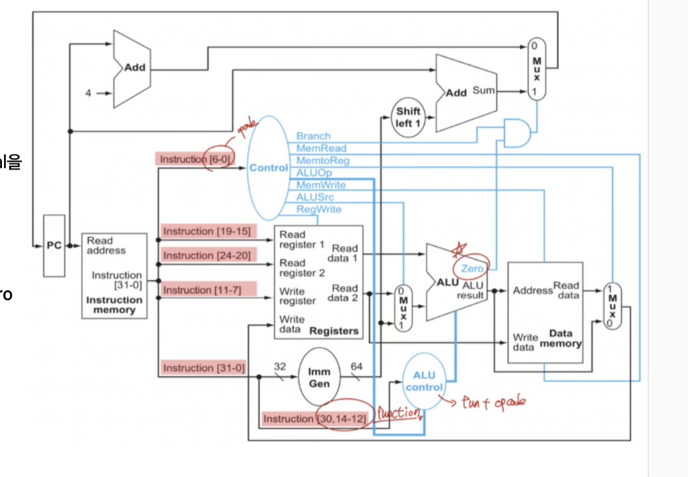
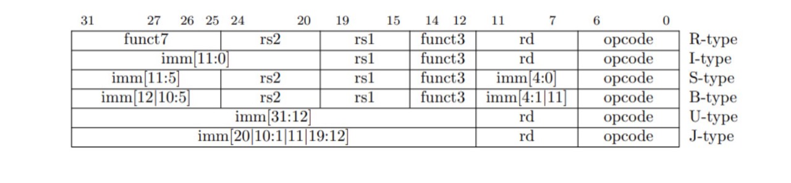
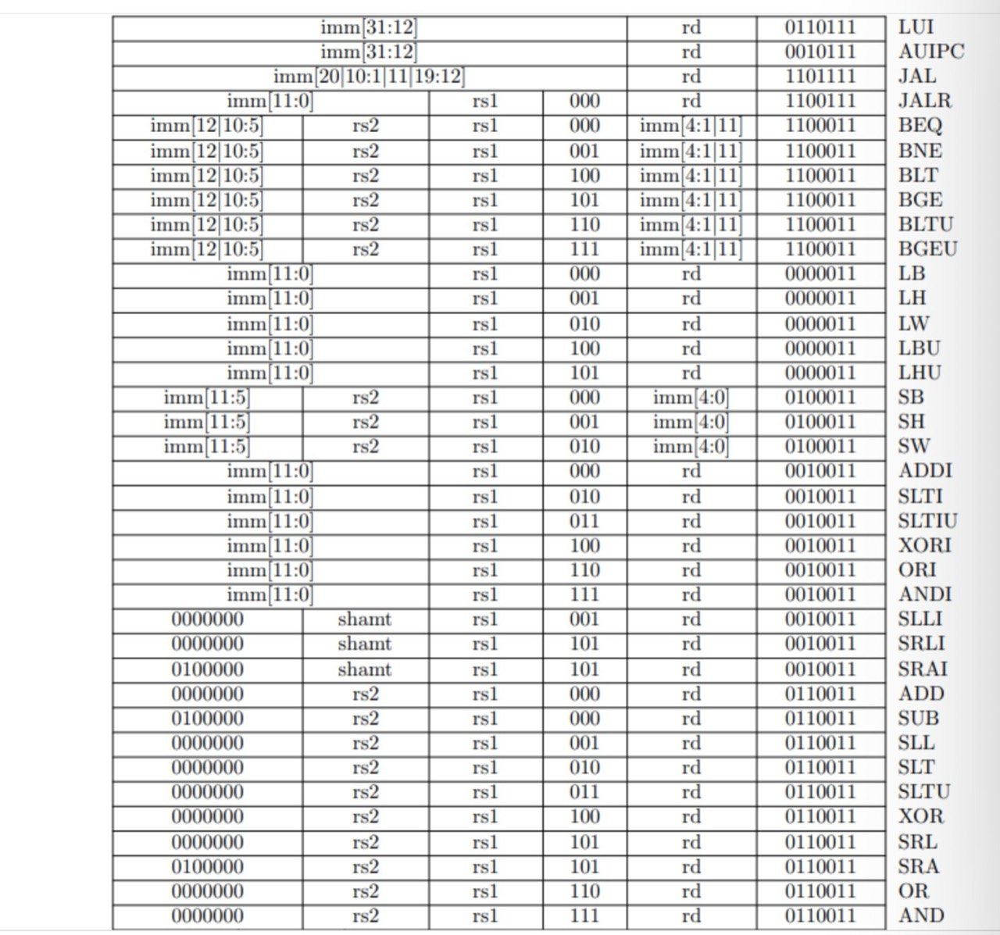

# RISC-V Single-Cycle CPU

Verilog / Vivado learning project: a 32-bit single-cycle RISC-V CPU datapath.
This repository preserves a work-in-progress source snapshot, not a fully
verified RV32I implementation.

## Structure

- `RISCV.xpr`: original Vivado project, target `xc7z020clg400-1`.
- `RISCV.srcs/sources_1/new/`: CPU RTL and historical source files.
- `RISCV.srcs/sim_1/new/`: CPU and module testbenches.
- `instruction.hex.txt`: current instruction-memory input (LUI, AUIPC, NOP).
- `single_cycle_cpu_tb_behav.wcfg`: saved waveform configuration.

Design top: `single_cycle_cpu` in `single_cycle_cpu.v`.
Simulation top: `single_cycle_cpu_tb`.
`top.v` is an older implementation with the same module name; it is retained
for history but is NOT included in the active XPR file set. Do not compile it
together with `single_cycle_cpu.v`. `control_unit_tb.v` is another historical
file outside the active XPR file set.

## Learning Scope

The source includes a program counter, instruction memory, register file,
immediate generator, control unit, ALU control, ALU, data memory and branch
control. Learning work covers arithmetic, loads/stores, conditional branches,
JAL/JALR and LUI/AUIPC. Opcode support alone is not proof of complete ISA support.

The learner wrote and revised RTL/TBs in Vivado with AI-assisted explanations,
examples and review. Independent authorship of every line is not claimed.
The snapshot was copied without changing the original RTL.

## Study Images

These three images were supplied by the learner as study references. They are
not simulation evidence or generated schematics of this repository. Original
publication/source attribution has not yet been supplied; no original authorship
or license for these reference images is asserted.

### Datapath Reference

This reference labels the immediate output as 64 bits; this CPU uses 32-bit
data paths. The diagram also shows a separate branch-immediate shift, whereas
the implementation constructs the branch immediate in the immediate generator.
It is a conceptual reference, not an exact representation of the current RTL.

### Instruction Formats

### Instruction Encodings

The table is a learning reference, not a list of verified instructions. Not
every encoding has been tested against this implementation.

## Verification Status

Earlier learning sessions include a JALR waveform showing target PC `0x14`
and link write-back `0x08`, and a user report of U-type TB completion.
Those historical captures are not archived in this repository and do not
establish that this exact snapshot passes simulation.

The current CPU TB applies reset and runs for 200 ns afterwards. It does not
automatically compare architectural results. No new simulation, synthesis,
timing closure or board execution is claimed by this upload.

## Known Issues / Reproduction Limits

- `data_memory.v` declares `read_data` as a net but assigns it procedurally;
  the Verilog declaration needs correction before compilation.
- `control_unit.v` does not assign `lui` and `auipc` in every opcode branch;
  incomplete combinational assignments can retain stale control values.
- JALR target calculation does not yet clear bit 0.
- LH sign extension uses bit 7 instead of bit 15.
- Byte/halfword accesses always select the low lane; address low bits are not
  used to select the byte/halfword inside a word.
- Instruction memory uses a local absolute path in `$readmemh`. On another
  computer, update the upload copy to point to `instruction.hex.txt` in the
  simulator working directory before running.
- Reset-time register/memory write control and instruction-level edge cases
  still need tests. FENCE/ECALL/EBREAK are not claimed as implemented.

Open `RISCV.xpr` in Vivado to inspect the original file sets. When manually
adding sources to a new project, use the active XPR lists rather than adding
every `.v` file recursively. Resolve the issues above before expecting a
successful simulation. Vivado 2024.2 migration has not been validated.

## Next Steps

Correct compilation/control issues, add self-checking instruction tests and
timeouts, verify reset and memory lanes, then preserve logs and waveforms.
Branch/jump datapath consolidation and a separate pipeline project are future
work; this repository remains single-cycle.

Snapshot prepared: 2026-10-08.
